# Class diagram — RWA Tokenization & Compliance Protocols

> 🇪🇸 [Versión en español](./diagrama-de-clases-ES.md) · [Index](./README.md)

Structural view aligned with the v1 implementation (module 19).  
**Sync:** 2026-09-15 · Phases **IDENT → SOLV** ✅ · `forge test` → **80 PASS**.

> **Reference standard:** ERC-3643 (T-REX) style permissioned token: KYC via Identity Registry, modular compliance, freeze/pause, `forcedTransfer` and snapshot-based dividends.

## Diagram (Mermaid)

```mermaid
classDiagram
    direction TB

    class IIdentityRegistry {
        <<interface>>
        +isVerified(userAddress) bool
        +identity(userAddress) address
        +investorCountry(userAddress) uint16
        +contains(userAddress) bool
        +registerIdentity(userAddress, identity, country)
        +deleteIdentity(userAddress)
        +updateIdentity(userAddress, identity)
        +updateCountry(userAddress, country)
        +claimTopicsRegistry() address
        +trustedIssuersRegistry() address
    }

    class IIdentity {
        <<interface>>
        +addClaim(topic, issuer)
        +removeClaim(topic)
        +getClaim(topic) issuer, valid
    }

    class IClaimTopicsRegistry {
        <<interface>>
        +addClaimTopic(claimTopic)
        +removeClaimTopic(claimTopic)
        +getClaimTopics() uint256[]
    }

    class ITrustedIssuersRegistry {
        <<interface>>
        +addTrustedIssuer(trustedIssuer, claimTopics)
        +removeTrustedIssuer(trustedIssuer)
        +updateIssuerClaimTopics(trustedIssuer, claimTopics)
        +isTrustedIssuer(issuer) bool
        +hasClaimTopic(issuer, claimTopic) bool
        +getTrustedIssuers() address[]
        +getTrustedIssuerClaimTopics(trustedIssuer) uint256[]
    }

    class ICompliance {
        <<interface>>
        +canTransfer(from, to, amount) bool
        +transferred(from, to, amount)
        +created(to, amount)
        +destroyed(from, amount)
        +bindToken(token)
        +tokenBound() address
    }

    class IComplianceModule {
        <<interface>>
        +canTransfer(from, to, amount) bool
        +transferred(from, to, amount)
        +created(to, amount)
        +destroyed(from, amount)
        +compliance() address
    }

    class IRWAToken {
        <<interface>>
        +identityRegistry() address
        +setIdentityRegistry(identityRegistry_)
        +compliance() address
        +setCompliance(compliance_)
        +isAgent(account) bool
        +paused() bool
        +pause()
        +unpause()
        +isFrozen(account) bool
        +getFrozenTokens(account) uint256
        +getFreeBalance(account) uint256
        +setAddressFrozen(account, freeze)
        +freezePartialTokens(account, amount)
        +unfreezePartialTokens(account, amount)
        +forcedTransfer(from, to, amount) bool
        +mint(to, amount)
        +burn(account, amount)
        +snapshot() uint256
        +currentSnapshotId() uint256
        +balanceOfAt(account, snapshotId) uint256
        +totalSupplyAt(snapshotId) uint256
    }

    class IDividendDistributor {
        <<interface>>
        +rwaToken() address
        +createDistribution(paymentToken, totalAmount, snapshotId) uint256
        +depositPayment(distributionId)
        +claim(distributionId)
        +claimable(distributionId, account) uint256
        +hasClaimed(distributionId, account) bool
        +distributionCount() uint256
    }

    class RWAErrors {
        <<errors library>>
        +IdentityNotVerified()
        +TransferNotCompliant()
        +WalletFrozen()
        +InsufficientUnfrozenBalance()
        +InsufficientBalance()
        +TokenPaused()
        +TokenNotPaused()
        +UnauthorizedAgent()
        +AlreadyClaimed()
        +NothingToClaim()
        +InvalidSnapshot()
        +InvalidDistribution()
        +DistributionNotFunded()
        +AlreadyFunded()
        +ModuleAlreadyAdded()
        +TokenAlreadyBound()
        +OnlyBoundToken()
        +OnlyCompliance()
    }

    class Identity {
        +addClaim(topic, issuer)
        +removeClaim(topic)
        +getClaim(topic) issuer, valid
    }

    class IdentityRegistry {
        +isVerified(userAddress) bool
        +registerIdentity(userAddress, identity, country)
        +deleteIdentity(userAddress)
        +updateIdentity(userAddress, identity)
        +updateCountry(userAddress, country)
        +contains(userAddress) bool
    }

    class ClaimTopicsRegistry {
        +addClaimTopic(claimTopic)
        +removeClaimTopic(claimTopic)
        +getClaimTopics() uint256[]
    }

    class TrustedIssuersRegistry {
        +addTrustedIssuer(issuer, claimTopics)
        +removeTrustedIssuer(issuer)
        +isTrustedIssuer(issuer) bool
        +hasClaimTopic(issuer, topic) bool
    }

    class ModularCompliance {
        +bindToken(token)
        +addModule(module)
        +removeModule(module)
        +getModules() address[]
        +canTransfer(from, to, amount) bool
        +transferred(from, to, amount)
        +created(to, amount)
        +destroyed(from, amount)
        +tokenBound() address
    }

    class CountryRestrictModule {
        +identityRegistry IIdentityRegistry
        +setCountryRestricted(country, restricted)
        +isCountryRestricted(country) bool
        +canTransfer(from, to, amount) bool
    }

    class MaxBalanceModule {
        +token address
        +maxBalance uint256
        +setMaxBalance(maxBalance_)
        +canTransfer(from, to, amount) bool
    }

    class RWAToken {
        +AGENT_ROLE bytes32
        +mint(to, amount)
        +burn(account, amount)
        +forcedTransfer(from, to, amount) bool
        +pause() / unpause()
        +setAddressFrozen(account, freeze)
        +freezePartialTokens / unfreezePartialTokens
        +snapshot() uint256
        +balanceOfAt / totalSupplyAt
        +setCompliance(compliance_)
        +getFreeBalance(account) uint256
    }

    class DividendDistributor {
        +createDistribution(paymentToken, totalAmount, snapshotId) uint256
        +depositPayment(distributionId)
        +claim(distributionId)
        +claimable(distributionId, account) uint256
        +getDistribution(distributionId) ...
    }

    class Distribution {
        <<struct>>
        +address paymentToken
        +uint256 totalAmount
        +uint256 snapshotId
        +uint256 totalSupplyAt
        +uint256 claimedAmount
        +bool funded
    }

    class MockERC20 {
        <<mock>>
        +mint(to, amount)
        +decimals() uint8
    }

    IIdentityRegistry <|.. IdentityRegistry
    IIdentity <|.. Identity
    IClaimTopicsRegistry <|.. ClaimTopicsRegistry
    ITrustedIssuersRegistry <|.. TrustedIssuersRegistry
    ICompliance <|.. ModularCompliance
    IComplianceModule <|.. CountryRestrictModule
    IComplianceModule <|.. MaxBalanceModule
    IRWAToken <|.. RWAToken
    IDividendDistributor <|.. DividendDistributor

    IdentityRegistry --> IClaimTopicsRegistry : KYC topics
    IdentityRegistry --> ITrustedIssuersRegistry : issuers
    IdentityRegistry --> IIdentity : getClaim
    ModularCompliance --> IComplianceModule : AND canTransfer
    CountryRestrictModule --> IIdentityRegistry : investorCountry
    MaxBalanceModule --> RWAToken : balanceOf
    RWAToken --> IIdentityRegistry : isVerified
    RWAToken --> ICompliance : canTransfer / hooks
    RWAToken ..> RWAErrors : IdentityNotVerified
    DividendDistributor --> IRWAToken : balanceOfAt / totalSupplyAt
    DividendDistributor --> Distribution : stores
    DividendDistributor --> MockERC20 : lab USDC
```



## Responsibilities

| Artifact | Responsibility |
|----------|----------------|
| `Identity` | Lab claims (topic → issuer) managed by the owner |
| `IdentityRegistry` | Register/remove; `isVerified` = registered + claims from trusted issuers |
| `ClaimTopicsRegistry` | Mandatory KYC/AML topics |
| `TrustedIssuersRegistry` | Trusted issuers + authorized topics |
| `ModularCompliance` | `bindToken` + AND of modules + hooks callable only by the token |
| `CountryRestrictModule` | Blocks `from`/`to` with a restricted country |
| `MaxBalanceModule` | Cap `balanceOf(to) + amount ≤ maxBalance` |
| `RWAToken` | Permissioned ERC-20: KYC, pause, freeze, forced, snapshots, compliance |
| `DividendDistributor` | create → deposit → pro-rata claim (CEI + reentrancy guard) |
| `MockERC20` | Lab USDC (6 decimals) |
| `RWAErrors` | Module custom errors |

## Transfer permission model

```
  transfer / transferFrom  (and mint via canTransfer(0,to,amount) if compliance is bound)
           │
           ▼
  ┌────────────────────┐
  │ paused?            │──yes─► TokenPaused
  └─────────┬──────────┘
            │ no
            ▼
  ┌────────────────────┐
  │ from/to frozen?    │──yes─► WalletFrozen
  └─────────┬──────────┘
            │ no
            ▼
  ┌────────────────────┐
  │ isVerified(from/to)│──no──► IdentityNotVerified
  └─────────┬──────────┘
            │ yes
            ▼
  ┌────────────────────┐
  │ free balance OK?   │──no──► InsufficientUnfrozenBalance
  └─────────┬──────────┘
            │ yes
            ▼
  ┌────────────────────┐
  │ compliance bound?  │──no──► skip
  │ canTransfer(...)   │──fail─► TransferNotCompliant
  └─────────┬──────────┘
            │ ok
            ▼
      _update balances
      compliance.transferred / created / destroyed
```

> `forcedTransfer`: bypasses pause, freeze, `isVerified(from)` and `canTransfer`; requires `isVerified(to)` and `to` not frozen; then runs the `transferred` hook if compliance is bound.

## Roles

| Role | Mechanism | Actions |
|------|-----------|---------|
| Admin | `DEFAULT_ADMIN_ROLE` | `addAgent`, `setIdentityRegistry`, `setCompliance` |
| Agent | `AGENT_ROLE` | mint/burn, pause, freeze, snapshot, `forcedTransfer` |
| Identity owner | `Ownable2Step` on registries | registerIdentity, topics, issuers |
| Dividend manager | `Ownable2Step` on distributor | createDistribution, depositPayment |
| Holder | — | transfer (if KYC + compliance), claim |

## Custom errors (implemented)

| Error | Usage |
|-------|-------|
| `IdentityNotVerified()` | transfer/mint/forced recipient without KYC |
| `TransferNotCompliant()` | a compliance module rejects |
| `WalletFrozen()` | full freeze on from/to (or forced recipient) |
| `InsufficientUnfrozenBalance()` | insufficient free balance / excessive unfreeze |
| `InsufficientBalance()` | forcedTransfer without enough total balance |
| `TokenPaused()` / `TokenNotPaused()` | invalid pause / unpause |
| `UnauthorizedAgent()` | `forcedTransfer` without `AGENT_ROLE` |
| `AlreadyClaimed()` / `NothingToClaim()` | dividend lifecycle |
| `InvalidSnapshot()` / `InvalidDistribution()` | invalid snapshot or distribution id |
| `DistributionNotFunded()` / `AlreadyFunded()` | claim without funding / double deposit |
| `ModuleAlreadyAdded()` / `ModuleNotFound()` | module management |
| `TokenAlreadyBound()` / `OnlyBoundToken()` / `OnlyCompliance()` | compliance binding |
