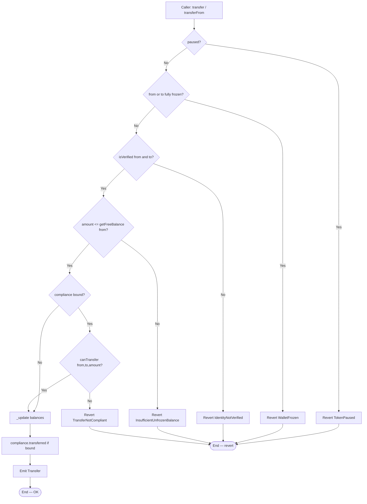
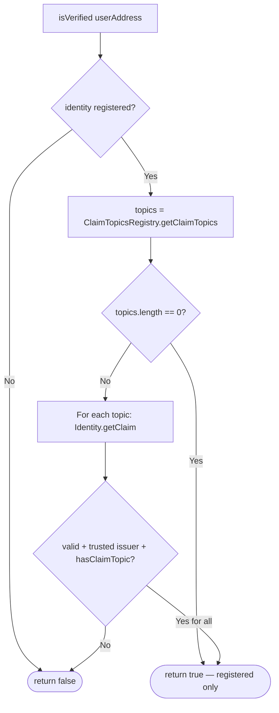
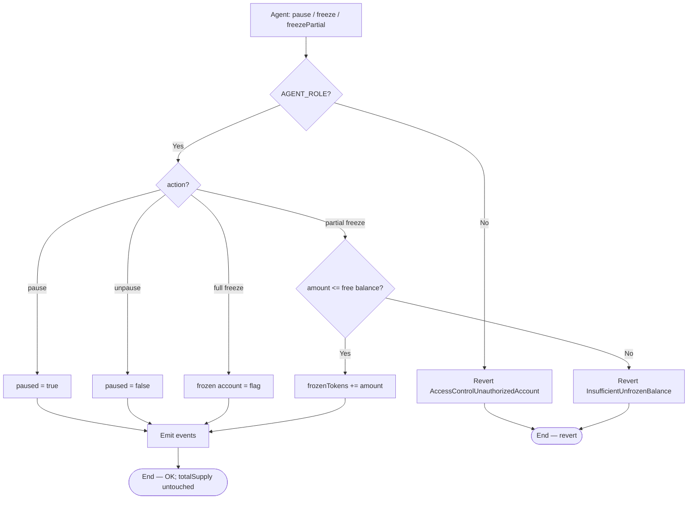
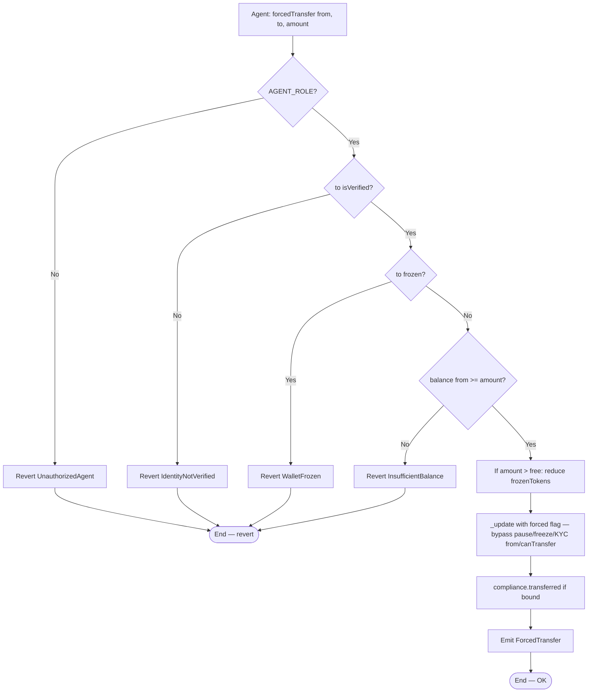
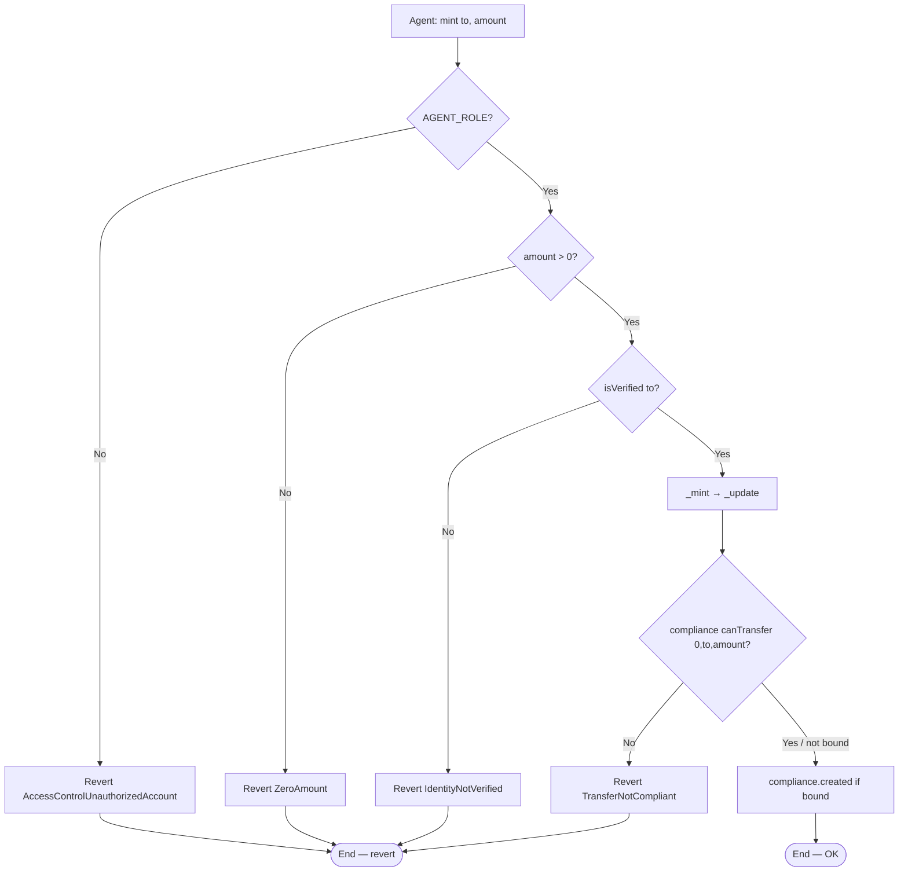

# Flow diagram — Identity, transfers, freeze, compliance and dividends

> 🇪🇸 [Versión en español](./diagrama-de-flujo-ES.md) · [Index](./README.md)

Internal decision flows of the RWA protocol (module 19, **v1 implemented**).  
**Sync:** 2026-09-15 · Phases **IDENT → SOLV** ✅ · 80 PASS.

## 1. transfer / transferFrom (permissioned)

> Actual order in `_update`: pause → freeze → KYC → free balance → compliance.  
> If `compliance == address(0)`, `canTransfer` / hooks are skipped.

---

## 2. isVerified (Identity Registry)

> Lab: claims are written by the `Identity` owner (`addClaim`). There is no production-grade ONCHAINID cryptographic verification.

---

## 3. Full / partial freeze and global pause

> Pause/freeze use `onlyRole(AGENT_ROLE)` (OZ AccessControl error).  
> `forcedTransfer` uses an explicit `UnauthorizedAgent`.

---

## 4. forcedTransfer (recovery)

---

## 5. Dividends — createDistribution → depositPayment → claim

```mermaid
flowchart TD
    A[Owner: createDistribution paymentToken, total, snapshotId] --> B{totalSupplyAt snapshot > 0?}
    B -->|No| Z0[Revert InvalidSnapshot]
    B -->|Yes| C[Store Distribution funded=false]
    C --> D[Emit DistributionCreated]

    E[Owner: depositPayment distributionId] --> F{already funded?}
    F -->|Yes| Z1[Revert AlreadyFunded]
    F -->|No| G[safeTransferFrom owner → distributor for totalAmount]
    G --> H[funded = true]
    H --> I[Emit DistributionFunded]

    J[Holder: claim distributionId] --> K{funded?}
    K -->|No| Z2[Revert DistributionNotFunded]
    K -->|Yes| L{already claimed?}
    L -->|Yes| Z3[Revert AlreadyClaimed]
    L -->|No| M[share = balanceOfAt * total / totalSupplyAt]
    M --> N{share > 0?}
    N -->|No| Z4[Revert NothingToClaim]
    N -->|Yes| O[claimed=true; claimedAmount+=share — CEI]
    O --> P[safeTransfer paymentToken → holder]
    P --> Q[Emit Claimed]
    Q --> Ok([End — OK])
    Z0 --> End([End — revert])
    Z1 --> End
    Z2 --> End
    Z3 --> End
    Z4 --> End
```

> `depositPayment(distributionId)` does **not** take an amount: it always transfers `totalAmount`.  
> Flooring: `Σ claims ≤ totalAmount` (dust may remain in the contract).

---

## 6. mint (agent → verified)

> Mint is **not** blocked by the global pause (only wallet↔wallet transfers are). MaxBalanceModule can still reject a mint.
