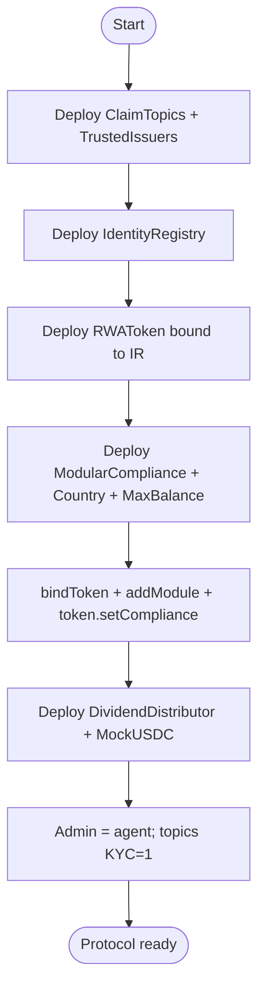
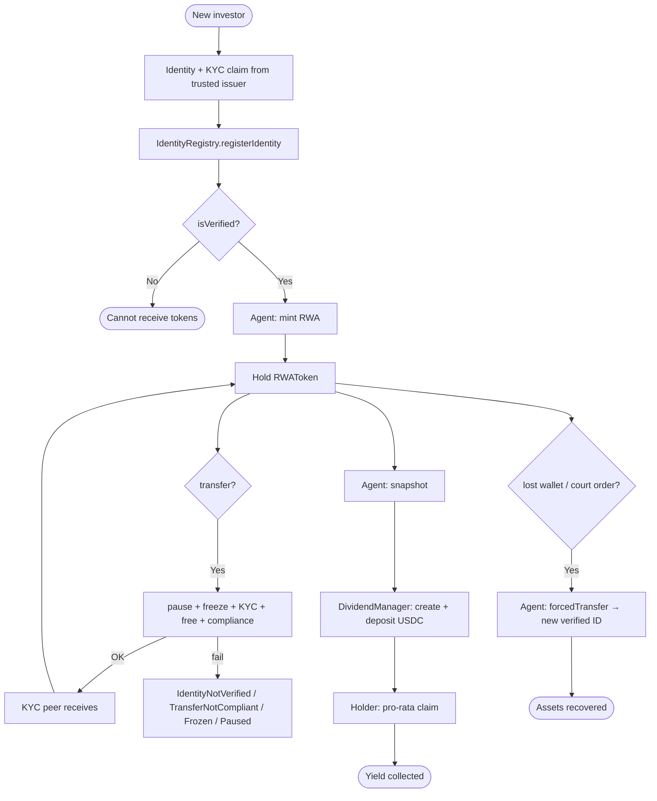
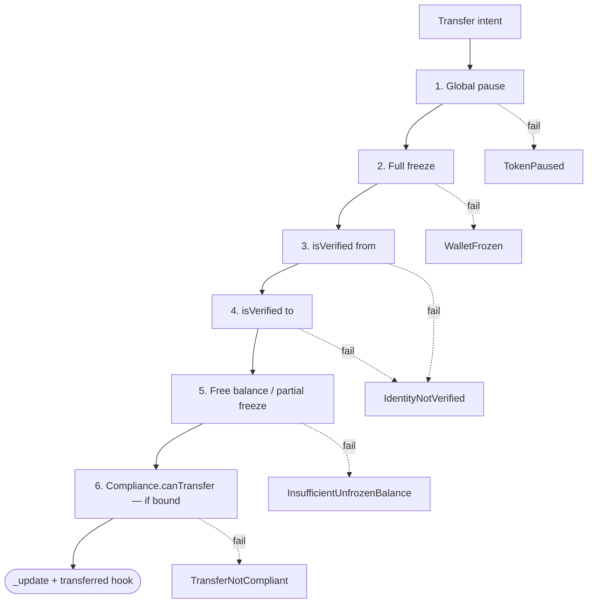
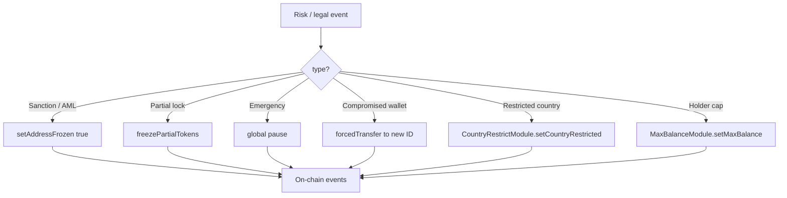
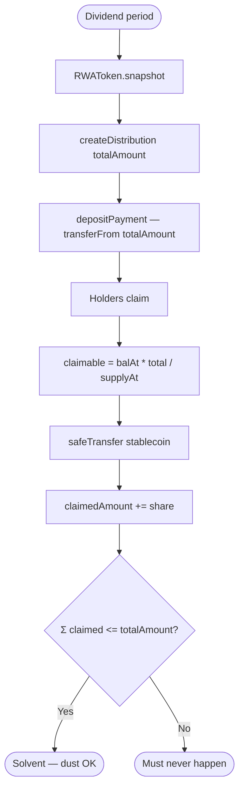
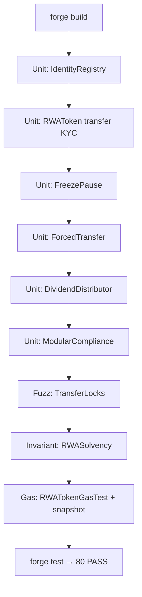

# Flowchart — Full RWA Tokenization & Compliance lifecycle

> 🇪🇸 [Versión en español](./flujograma-ES.md) · [Index](./README.md)

End-to-end flow (module 19, **v1 implemented**).  
**Sync:** 2026-09-15 · Phases **IDENT → SOLV** ✅ · 80 PASS.

## Actors

| Actor | Role |
|-------|------|
| Issuer / Admin | Deploy; `DEFAULT_ADMIN_ROLE`; configures IR, compliance, agents |
| Agent | mint/burn, pause, freeze, snapshot, `forcedTransfer` |
| Claim Issuer | Trusted issuer of KYC claims (lab) |
| KYC investor | Verified wallet; holds, transfers, claims dividends |
| Non-KYC investor | No identity; transfer/mint revert |
| ModularCompliance | AND of country / max balance modules |
| IdentityRegistry | Source of `isVerified` + `investorCountry` |
| Dividend manager | Owner of `DividendDistributor` |
| CI / Foundry | Unit, lock fuzzing, invariants, gas, SWC |

---

## Flowchart — Deploy and wiring (v1)

> Script: `script/Deploy.s.sol`. Env: `.env.example` (`TOKEN_NAME`, `TOKEN_SYMBOL`, `MAX_BALANCE`).

---

## Main flowchart — Onboard → Hold → Transfer → Yield → Recovery

---

## Flowchart — Transfer defense layers

---

## Flowchart — Compliance agent lifecycle

---

## Flowchart — Yield accounting (snapshot)

---

## Flowchart — Foundry tooling (lab)

---

## Related docs

| Document | Contents |
|----------|----------|
| [diagrama-de-clases-EN.md](./diagrama-de-clases-EN.md) | Contracts, interfaces, modules (real API) |
| [diagrama-de-flujo-EN.md](./diagrama-de-flujo-EN.md) | Internal per-function decisions |
| [planificacion-EN.md](./planificacion-EN.md) | IDENT→SOLV phases (closed) |
| [SWC-AUDIT-EN.md](./SWC-AUDIT-EN.md) | SWC-100–136 matrix |
| [GAS-EN.md](./GAS-EN.md) | Gas baseline |
